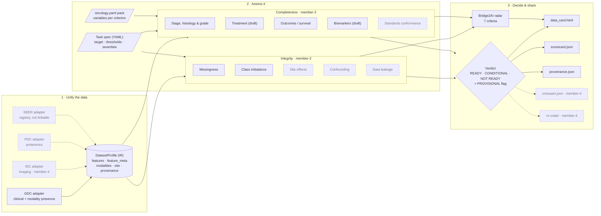

# AI-Readiness Scorecard

**Does this oncology dataset support this AI task, and if not, what is missing?**

A Python package that profiles a dataset from the NCI Cancer Research Data Commons (CRDC) against a declared AI task. It returns a READY / CONDITIONAL / NOT READY verdict, with blocking deficiencies kept separate from degrading ones and every finding linked to its evidence.

NCI Data Jamboree 2026 project · University of Illinois Cancer Center
Lead: Nikita Thakur ([@nikitasthakur](https://github.com/nikitasthakur)) · Team: Saransh Singh ([@singh2626ss](https://github.com/singh2626ss)), Juhi Anand ([@ajuhia](https://github.com/ajuhia)), Lakshmi Sravya Rachakonda ([@Sravya1802](https://github.com/Sravya1802))

> **Status: walking skeleton (v0.1).** The whole pipeline runs end to end on live TCGA-BRCA data. Six of the ten checks are implemented and four are registered stubs, so every verdict is marked **PROVISIONAL**. See [Team tasks](#team-tasks) for who owns what.

## The five clinical questions

The scorecard assesses TCGA-BRCA and SEER against five breast cancer questions from Dr. Gadi, each as its own task with a population, a variable list and its own checks. Start with [docs/FIVE_QUESTIONS.md](docs/FIVE_QUESTIONS.md). Before touching any data, read [docs/DATA_HANDLING.md](docs/DATA_HANDLING.md). Known gaps are in [docs/LIMITATIONS.md](docs/LIMITATIONS.md).

```bash
scorecard tasks                       # the five questions plus survival-prediction
scorecard profile --snapshot tests/fixtures/gdc_tcga_brca_40.json --task chemo-benefit --out out/demo-q1
scorecard grid --runs out --out out/grid.html
```

## Quick start

You need Python 3.10 or newer. [uv](https://docs.astral.sh/uv/) is recommended; plain `pip` also works.

```bash
git clone https://github.com/Sravya1802/ai-readiness-scorecard.git
cd ai-readiness-scorecard
uv venv && source .venv/bin/activate
uv pip install -e ".[dev]"

# Offline, from the 40-patient fixture (no network needed)
scorecard profile --snapshot tests/fixtures/gdc_tcga_brca_40.json --out out/fixture

# Live, all 1,098 TCGA-BRCA patients from the GDC open-access API (about 20 s, cached afterwards)
scorecard profile --dataset TCGA-BRCA --task survival-prediction --out out/tcga-brca
open out/tcga-brca/data_card.html
```

`python -m scorecard ...` works the same as `scorecard ...`.

Other commands:

| Command | What it does |
|---|---|
| `scorecard checks` | All registered checks, with family, owner and real/stub state |
| `scorecard adapters` | Repository adapters (GDC is real; IDC, PDC and SEER are stubs) |
| `scorecard tasks` | Task specs |
| `scorecard snapshot --dataset TCGA-BRCA --limit 40 --out file.json` | Save a raw snapshot, for fixtures or offline runs |
| `pytest` | Offline tests. `pytest -m network` runs the live-API test. |

## What a run produces

| File | Contents |
|---|---|
| `data_card.html` | Human-readable report in the layout of the project prototype: verdict, Bridge2AI radar, multimodal linkage, the two check families, and an evidence section for every finding |
| `scorecard.json` | Everything in the data card, machine-readable |
| `provenance.json` | Which checks ran, on which snapshot (SHA-256), with which tool, pack, task and library versions |
| `croissant.json`, `ro-crate/` | Not built yet (owner: Member 4) |

## First live result (TCGA-BRCA, GDC Data Release 46)

| Check | Result |
|---|---|
| Missingness | WARN: 7.1% overall; `tumor_grade` is 100% missing; 9 features' missingness is associated with site or outcome |
| Class imbalance | PASS: 101 patients in the minority class at 5 years (just over the threshold of 100); 151 deaths in total |
| Stage, histology & grade | WARN: 83% coverage, held down by tumor grade |
| Treatment / Outcomes / Biomarkers | PASS: 100% / 100% / 94% (treatment and biomarkers are draft mappings) |
| Site effects, confounding, leakage, standards conformance | Not yet assessed |

Verdict: **CONDITIONAL (provisional)**. Two degrading deficiencies and none blocking, with four checks still to build.

## Architecture

Every repository is converted into one shared shape, the **DatasetProfile**. Two families of checks assess it against a declared task, and the verdict separates **blocking** deficiencies (the task can't be done soundly) from **degrading** ones (the model will be weaker).

Solid boxes are implemented. Dashed boxes are registered stubs, each labelled with its owner.



### The stages

| Stage | Code | What it does |
|---|---|---|
| 1. Adapter | `adapters/` | Downloads one repository's data (`fetch_raw`, the only step that uses the network) and converts it into the shared shape (`build_profile`, pure). A saved download can be re-run, so results are reproducible and tests run offline. |
| 2. DatasetProfile | `profile.py` | One row per patient. Every column is labelled with a modality and a role: feature, target (outcome), identifier, or site. Checks only use feature columns as inputs, so the outcome can never leak in as a predictor. |
| 3. Checks | `checks/` | Ten checks in two families. **Data integrity** works for any dataset; **oncology completeness** is cancer-specific. Each returns a status, a severity, a summary, and the evidence behind it. |
| 4. Verdict | `verdict.py` | Combines the results (rules below) and scores the seven Bridge2AI criteria for the radar chart. |
| 5. Report | `report/` | Writes the data card, `scorecard.json` and `provenance.json`. |

Thresholds and requirements live in YAML, not code: [`tasks/survival_prediction.yaml`](src/scorecard/tasks/survival_prediction.yaml) says what the task needs, and [`packs/oncology.yaml`](src/scorecard/packs/oncology.yaml) lists the cancer variables each completeness check looks for. Because the thresholds belong to the task, the same dataset can be ready for one task and not another.

### Verdict rules

| Condition | Verdict |
|---|---|
| Any FAIL with blocking severity | NOT READY |
| Otherwise, any WARN or degrading FAIL | CONDITIONAL |
| Otherwise | READY |
| Any check still a stub | add **PROVISIONAL** |

More detail (module ownership diagram, field-level contracts, the proposed check-to-Bridge2AI mapping, GDC data quirks) is in [docs/ARCHITECTURE.md](docs/ARCHITECTURE.md).

## Team tasks

| Role | Person | Owns | Tasks | Done when |
|---|---|---|---|---|
| **Lead**: contracts, integration, demo | Nikita Thakur | `profile.py`, `adapters/base.py`, `checks/base.py`, `verdict.py`, `pipeline.py`, `adapters/gdc.py` | Review every change to the shared contracts. Load GDC gene expression and mutation matrices into the profile (TODO at the end of `adapters/gdc.py`). Guard scope. Final presentation. | The IR has not changed for two weeks; molecular features appear in the profile |
| **Member 2**: statistical engine | _name TBD_ | `checks/integrity/` | Build **site effects** (cross-validated site AUC against a permutation null), **confounding** (Cramér's V between site and target) and **data leakage** (identifier columns, patient straddle, near-duplicates, single-feature leaks). Specs are in [`checks/integrity/stubs.py`](src/scorecard/checks/integrity/stubs.py). Make sure every model the tool fits sits inside CV folds. | All five integrity checks are real, with evidence and tests |
| **Member 3**: oncology domain pack | _name TBD_ | `packs/oncology.yaml`, `checks/completeness/` | Build **standards conformance** (AJCC, ICD-O-3, ICD-10, mCODE); spec in [`checks/completeness/standards.py`](src/scorecard/checks/completeness/standards.py). Review the draft **treatment** and **biomarker** mappings. Confirm TCGA-BRCA fields mean what the pack assumes. | No criterion carries a DRAFT label |
| **Member 4** (proposed): outputs and linkage | _name TBD_ | `report/`, `adapters/idc.py` | Build **Croissant** export with the RAI extension carrying our findings, and **RO-Crate** packaging; specs in [`report/croissant.py`](src/scorecard/report/croissant.py) and [`report/rocrate.py`](src/scorecard/report/rocrate.py). At the event, build the **IDC adapter** and fill the imaging row of the linkage panel. | `croissant.json` validates; the IDC row shows real numbers |

The Member 4 role is a proposal, because the original role notes stop after Member 3. Fill in names once the team agrees.

### What is built and what is left

| Piece | State | Owner |
|---|---|---|
| DatasetProfile, adapter base, check registry, pipeline, verdict, CLI | ✅ Real | Lead |
| GDC adapter: clinical, ER/PR/HER2, modality presence | ✅ Real | Lead |
| GDC gene expression and mutation matrices | ⬜ Presence only | Lead |
| Missingness, class imbalance | ✅ Real | Member 2 |
| Site effects, confounding, data leakage | ⬜ Stub with spec | Member 2 |
| Stage/histology/grade, outcomes | ✅ Real | Member 3 |
| Treatment, biomarkers | 🟨 Real, draft mapping | Member 3 |
| Standards conformance | ⬜ Stub with spec | Member 3 |
| Data card, scorecard.json, provenance.json | ✅ Real | Member 4 |
| Croissant, RO-Crate, IDC adapter | ⬜ Stub with spec | Member 4 |
| PDC, SEER adapters | ⬜ Stub | Unassigned |

### Schedule

Prework runs October 5 to November 13, 2026. The event is **November 16–18, 2026**.

| Week | Lead | Member 2 | Member 3 | Member 4 |
|---|---|---|---|---|
| Oct 5–9 | Push repo; everyone runs it; review the IR together | Read stub specs | Review pack and task YAML | Compare data card with the prototype |
| Oct 12–16 | Freeze the IR (v0.2) | Site effects | Conformance vocabularies | Croissant |
| Oct 19–23 | Expression matrix | Confounding | Conformance check and tests | Croissant RAI fields; validate |
| Oct 26–30 | Mutation matrix | Leakage | Treatment and biomarker review | RO-Crate |
| Nov 2–6 | First non-provisional verdict | Speed up permutation test | Threshold review | IDC exploration |
| Nov 9–13 | Demo dry run; freeze `main` | Buffer and fixes | Buffer and fixes | Buffer and fixes |

| Event day | Goal |
|---|---|
| Day 1 | Onboard collaborators; start the IDC adapter |
| Day 2 | Imaging row on the linkage panel; optionally a second TCGA project to show the pack generalizes |
| Day 3 | Freeze by midday; final data card; tagged GitHub release |

### Open questions

1. **Check count.** The prototype slide says "16 of 16 checks"; the deck defines 10. Are six more intended?
2. **Radar mapping.** Provenance, Ethics and Sustainability have no check yet.
3. **Tumor grade** is 100% missing in GDC TCGA-BRCA. Should it stay required for breast?
4. **License.** MIT is a placeholder pending the lead's confirmation.
5. **Member 4.** Confirm the role and who takes it.

Risks and the full plan are in [docs/TECHNICAL_PLAN.md](docs/TECHNICAL_PLAN.md). Read [CONTRIBUTING.md](CONTRIBUTING.md) before your first PR.

## Repository layout

```
src/scorecard/
  profile.py              DatasetProfile: the shared intermediate representation
  adapters/               gdc.py (real); idc.py, pdc.py, seer.py (stubs)
  checks/integrity/       missingness, class imbalance (real); site effects, confounding, leakage (stubs)
  checks/completeness/    pack-driven engine + criteria (real); standards conformance (stub)
  packs/oncology.yaml     variable inventory per completeness criterion
  tasks/*.yaml            what each AI task requires: target, thresholds, severities
  verdict.py              blocking vs degrading -> verdict; Bridge2AI radar scores
  report/                 data card, scorecard.json, provenance; Croissant and RO-Crate stubs
  pipeline.py, cli.py
tests/                    offline tests against a real 40-patient fixture
docs/                     architecture and technical plan
```

## Data access

The tool uses only open-access data. It reads from the public GDC API without credentials. Never commit controlled-access data or SEER extracts.

## License

MIT (placeholder, pending confirmation by the project lead).
