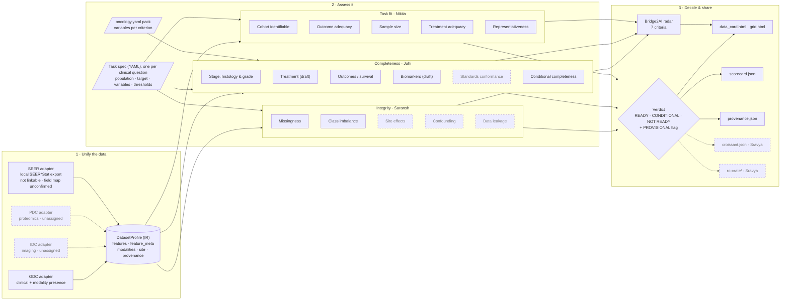

# AI-Readiness Scorecard

**Does this oncology dataset support this AI task, and if not, what is missing?**

A Python package that profiles a dataset from the NCI Cancer Research Data Commons (CRDC) against a declared AI task. It returns a READY / CONDITIONAL / NOT READY verdict, with blocking deficiencies kept separate from degrading ones and every finding linked to its evidence.

NCI Data Jamboree 2026 project · University of Illinois Cancer Center
Lead: Nikita Thakur ([@nikitasthakur](https://github.com/nikitasthakur)) · Team: Saransh Singh ([@singh2626ss](https://github.com/singh2626ss)), Juhi Anand ([@ajuhia](https://github.com/ajuhia)), Lakshmi Sravya Rachakonda ([@Sravya1802](https://github.com/Sravya1802))

> **Status: as presented at the NCI Data Jamboree, November 18, 2026.** The pipeline runs end to end on live TCGA-BRCA data and assesses Dr. Gadi's five breast cancer questions. The SEER adapter is built but has not yet been run on a real export, every clinical cutoff is a draft awaiting clinician review, and four general checks are still stubs. See [Team tasks](#team-tasks) for who owns what is left.

## The five clinical questions

The scorecard assesses TCGA-BRCA and SEER against five breast cancer questions from Dr. Gadi, each as its own task with a population, a variable list and its own checks. Start with [docs/FIVE_QUESTIONS.md](docs/FIVE_QUESTIONS.md). Before touching any data, read [docs/DATA_HANDLING.md](docs/DATA_HANDLING.md). Known gaps are in [docs/LIMITATIONS.md](docs/LIMITATIONS.md).

```bash
scorecard tasks                       # the five questions plus survival-prediction
scorecard profile --snapshot tests/fixtures/gdc_tcga_brca_40.json --task chemo-benefit --out out/demo-q1
scorecard grid --runs out --out out/grid.html
```

## Quick start

You need Python 3.10 or newer. [uv](https://docs.astral.sh/uv/) is recommended; plain `pip` also works.

```bash
git clone https://github.com/Sravya1802/ai-readiness-scorecard.git
cd ai-readiness-scorecard
uv venv && source .venv/bin/activate
uv pip install -e ".[dev]"

# Offline, from the 40-patient fixture (no network needed)
scorecard profile --snapshot tests/fixtures/gdc_tcga_brca_40.json --out out/fixture

# Live, all 1,098 TCGA-BRCA patients from the GDC open-access API (about 20 s, cached afterwards)
scorecard profile --dataset TCGA-BRCA --task survival-prediction --out out/tcga-brca
open out/tcga-brca/data_card.html
```

`python -m scorecard ...` works the same as `scorecard ...`.

Other commands:

| Command | What it does |
|---|---|
| `scorecard checks` | All registered checks, with family, owner and real/stub state |
| `scorecard adapters` | Repository adapters (GDC and SEER are real; IDC and PDC are stubs) |
| `scorecard reference` | Summarize SEER as a reference population for a task (counts and shares only) |
| `scorecard grid` | Lay out every run as a questions × datasets grid |
| `scorecard tasks` | Task specs |
| `scorecard snapshot --dataset TCGA-BRCA --limit 40 --out file.json` | Save a raw snapshot, for fixtures or offline runs |
| `pytest` | Offline tests. `pytest -m network` runs the live-API test. |

## What a run produces

| File | Contents |
|---|---|
| `data_card.html` | Human-readable report in the layout of the project prototype: verdict, Bridge2AI radar, multimodal linkage, the two check families, and an evidence section for every finding |
| `scorecard.json` | Everything in the data card, machine-readable |
| `provenance.json` | Which checks ran, on which snapshot (SHA-256), with which tool, pack, task and library versions |
| `grid.html` | From `scorecard grid`: every question against every dataset on one page |
| `croissant.json`, `ro-crate/` | Not built yet (owner: Lakshmi Sravya Rachakonda) |

## First live result (TCGA-BRCA, GDC Data Release 46)

| Check | Result |
|---|---|
| Missingness | WARN: 7.1% overall; `tumor_grade` is 100% missing; 9 features' missingness is associated with site or outcome |
| Class imbalance | PASS: 101 patients in the minority class at 5 years (just over the threshold of 100); 151 deaths in total |
| Stage, histology & grade | WARN: 83% coverage, held down by tumor grade |
| Treatment / Outcomes / Biomarkers | PASS: 100% / 100% / 94% (treatment and biomarkers are draft mappings) |
| Site effects, confounding, leakage, standards conformance | Not yet assessed |

Verdict: **CONDITIONAL (provisional)**. Two degrading deficiencies and none blocking, with four checks still to build.

## Architecture

Every repository is converted into one shared shape, the **DatasetProfile**. Two families of checks assess it against a declared task, and the verdict separates **blocking** deficiencies (the task can't be done soundly) from **degrading** ones (the model will be weaker).

Solid boxes are implemented. Dashed boxes are registered stubs, each labelled with its owner.



### The stages

| Stage | Code | What it does |
|---|---|---|
| 1. Adapter | `adapters/` | Downloads one repository's data (`fetch_raw`, the only step that uses the network) and converts it into the shared shape (`build_profile`, pure). A saved download can be re-run, so results are reproducible and tests run offline. |
| 2. DatasetProfile | `profile.py` | One row per patient. Every column is labelled with a modality and a role: feature, target (outcome), identifier, or site. Checks only use feature columns as inputs, so the outcome can never leak in as a predictor. |
| 3. Checks | `checks/` | Three families. **Data integrity** works for any dataset; **oncology completeness** is cancer-specific; **task fit** asks whether the dataset can answer one clinical question (right patients, outcome, sample size, treatment records, representativeness). Each check returns a status, a severity, a summary, and the evidence behind it. |
| 4. Verdict | `verdict.py` | Combines the results (rules below) and scores the seven Bridge2AI criteria for the radar chart. |
| 5. Report | `report/` | Writes the data card, `scorecard.json` and `provenance.json`. |

Thresholds and requirements live in YAML, not code: each file in [`tasks/`](src/scorecard/tasks/) says what one task needs, and [`packs/oncology.yaml`](src/scorecard/packs/oncology.yaml) lists the cancer variables each completeness check looks for. Because the thresholds belong to the task, the same dataset can be ready for one task and not another.

### Verdict rules

| Condition | Verdict |
|---|---|
| Any FAIL with blocking severity | NOT READY |
| Otherwise, any WARN or degrading FAIL | CONDITIONAL |
| Otherwise | READY |
| Any check still a stub | add **PROVISIONAL** |

More detail (module ownership diagram, field-level contracts, the proposed check-to-Bridge2AI mapping, GDC data quirks) is in [docs/ARCHITECTURE.md](docs/ARCHITECTURE.md).

## Team tasks

The Jamboree build is complete and the project is frozen as presented. The work below is what is left, assigned by person, for anyone who picks the project up again.

| Person | Area | Owns | Remaining tasks |
|---|---|---|---|
| **Nikita Thakur** ([@nikitasthakur](https://github.com/nikitasthakur)), lead | Five clinical questions, shared contracts, task-fit checks | `profile.py`, `pipeline.py`, `verdict.py`, `tasks/*.yaml`, `checks/task_fit/`, `adapters/gdc.py` | Get clinician sign-off from Dr. Gadi on every cutoff and record it under `clinical_review` in each task file. Merge the data guide (`docs/GETTING_THE_DATA.md`, still on the `five-questions` branch). Check the Q5 copy-number entry, which reports copy number as not carried although GDC has open copy-number files. Load the gene expression and mutation matrices into the profile. Finish the write-up in `docs/LIMITATIONS.md`. |
| **Saransh Singh** ([@singh2626ss](https://github.com/singh2626ss)) | Statistical engine | `checks/integrity/` | Build **site effects** (cross-validated site AUC against a permutation null), **confounding** (Cramér's V between site and target) and **data leakage** (identifier columns, patient straddle, near-duplicates, single-feature leaks); specs are in [`stubs.py`](src/scorecard/checks/integrity/stubs.py). Keep every fitted model, including the propensity model in treatment adequacy, inside CV folds. |
| **Juhi Anand** ([@ajuhia](https://github.com/ajuhia)) | Oncology domain pack and TCGA data | `packs/oncology.yaml`, `checks/completeness/`, `adapters/fieldmaps/tcga_brca.yaml` | Download the TCGA-BRCA supplement files (Clinical Supplement, TCGA-CDR, published subtype and HRD tables) into `data/tcga_brca/`, check the headers, and set `confirmed: true` in the TCGA field map. Build **standards conformance** (AJCC, ICD-O-3, ICD-10, mCODE). Accept FIGO staging alongside AJCC. Review the draft **treatment** and **biomarker** mappings. |
| **Lakshmi Sravya Rachakonda** ([@Sravya1802](https://github.com/Sravya1802)), repository admin | SEER and outputs | `adapters/seer.py`, `adapters/fieldmaps/seer_breast.yaml`, `report/` | Export the breast cancer case listing from SEER*Stat into `data/seer/` (account approved; first confirm whether the treatment fields need Research Plus). Check the headers and set `confirmed: true` in the SEER field map. Build the SEER reference population for the representativeness check. Confirm with SEER the small-cell rule for public reports and whether fitting a model on case-level rows is allowed (data use agreement item 19). Build the **Croissant** and **RO-Crate** exports; specs are in [`croissant.py`](src/scorecard/report/croissant.py) and [`rocrate.py`](src/scorecard/report/rocrate.py). |

The IDC (imaging) and PDC (proteomics) adapters are unassigned.

### What is built and what is left

| Piece | State | Owner |
|---|---|---|
| DatasetProfile, adapter base, check registry, pipeline, verdict, CLI | ✅ Real | Nikita Thakur |
| Five clinical question tasks (Q1 chemo benefit to Q5 HRD germline testing) | 🟨 Real; cutoffs are drafts awaiting clinician review | Nikita Thakur |
| Task-fit checks: cohort, outcome, sample size, treatment, representativeness | ✅ Real | Nikita Thakur |
| GDC adapter: clinical, ER/PR/HER2, modality presence, TCGA supplement join | ✅ Real; supplement field map unconfirmed | Nikita Thakur, Juhi Anand |
| GDC gene expression and mutation matrices | ⬜ Presence only | Nikita Thakur |
| Missingness, class imbalance | ✅ Real | Saransh Singh |
| Site effects, confounding, data leakage | ⬜ Stub with spec | Saransh Singh |
| Stage/histology/grade, outcomes, conditional completeness | ✅ Real | Juhi Anand |
| Treatment, biomarkers | 🟨 Real, draft mapping | Juhi Anand |
| Standards conformance | ⬜ Stub with spec | Juhi Anand |
| SEER adapter and reference population | 🟨 Real; field map unconfirmed, not yet run on a real export | Lakshmi Sravya Rachakonda |
| Data card, scorecard.json, provenance.json, results grid | ✅ Real | Lakshmi Sravya Rachakonda |
| Croissant, RO-Crate | ⬜ Stub with spec | Lakshmi Sravya Rachakonda |
| IDC, PDC adapters | ⬜ Stub | Unassigned |

### Open questions

1. **Clinical sign-off.** Every cutoff and population rule in the five task files is a draft until a clinician reviews it.
2. **SEER rules.** What the data use agreement allows in a public report, and whether a model may be fitted on case-level rows.
3. **Check count.** The prototype slide says "16 of 16 checks"; the code now has 16 registered, of which 4 are stubs.
4. **Radar mapping.** Provenance and Sustainability still have no check.
5. **Tumor grade** is 100% missing in GDC TCGA-BRCA. Should it stay required for breast?
6. **License.** MIT is a placeholder pending the lead's confirmation.

Risks and design notes are in [docs/TECHNICAL_PLAN.md](docs/TECHNICAL_PLAN.md). Read [CONTRIBUTING.md](CONTRIBUTING.md) before your first PR.

## Repository layout

```
src/scorecard/
  profile.py              DatasetProfile: the shared intermediate representation
  adapters/               gdc.py, seer.py, tcga_supplement.py (real); idc.py, pdc.py (stubs)
  adapters/fieldmaps/     source column names for TCGA-BRCA and SEER (unconfirmed)
  checks/integrity/       missingness, class imbalance (real); site effects, confounding, leakage (stubs)
  checks/completeness/    pack-driven engine, criteria, conditional completeness (real); standards conformance (stub)
  checks/task_fit/        cohort, outcome, sample size, treatment, representativeness (real)
  packs/oncology.yaml     variable inventory per completeness criterion
  tasks/*.yaml            the five clinical questions plus survival prediction
  verdict.py              blocking vs degrading -> verdict; Bridge2AI radar scores
  report/                 data card, results grid, scorecard.json, provenance; Croissant and RO-Crate stubs
  pipeline.py, cli.py
tests/                    offline tests against a real 40-patient fixture
scripts/                  check_no_data.py (run in CI), synthetic demo data
docs/                     architecture, technical plan, five questions, data handling, limitations
```

## Data access

TCGA-BRCA comes from the public GDC API without credentials. SEER needs a SEER*Stat account per person, and its case-level rows are covered by a data use agreement: they stay in the git-ignored `data/` folder and are never committed, shared or given to AI tools. Read [docs/DATA_HANDLING.md](docs/DATA_HANDLING.md) before touching any data.

## License

MIT (placeholder, pending confirmation by the project lead).
