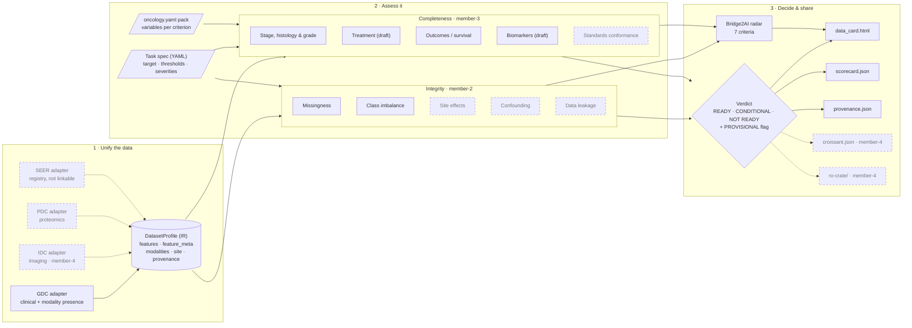
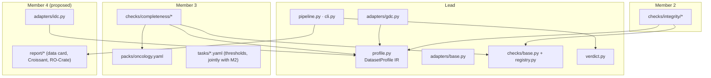

# Architecture

The scorecard answers one question: **does this dataset support this AI task, and if not, what is missing?** To answer it, the scorecard puts every repository into one shared shape, runs two families of checks against a declared task, and turns the results into a verdict that separates blocking deficiencies from degrading ones.

## 1. Pipeline

Solid boxes are implemented in v0.1. Dashed boxes are registered stubs, and each is labelled with its owner.



## 2. Modules and ownership



Arrows point from a module to the contract it depends on. The lead's column is what everyone else compiles against. That is why those files are frozen and changes to them go through the lead.

## 3. Contracts

### DatasetProfile (`profile.py`)

| Field | Type | Meaning |
|---|---|---|
| `features` | `pd.DataFrame` | One row per patient, indexed by patient id (the TCGA submitter id for GDC) |
| `feature_meta` | `dict[str, FeatureMeta]` | For every column: `modality`, `role` (feature / target / identifier / site), `source_field`, `description` |
| `modalities` | `pd.DataFrame[bool]` | Same index. Each column says whether the patient has that modality in the repository. This table is what the linkage matrix is built from. |
| `site_column` | `str \| None` | The column holding the site or batch label (for GDC, `tissue_source_site`) |
| `provenance` | `Provenance` | Adapter and version, query, retrieval time, data release, snapshot SHA-256, normalized missing-value strings, notes |

The constructor validates these invariants: unique patient index, exactly one `feature_meta` entry per column, the same index on `modalities`, boolean modality columns, and a site column whose role is `site`.

**Roles matter.** Checks treat only `FEATURE` columns as model inputs. Outcome columns are `TARGET`, so a check can never mistake the answer for an input. IDs are `IDENTIFIER`, and the leakage check will flag any feature that behaves like one.

### Adapter (`adapters/base.py`)

```python
class Adapter:
    def fetch_raw(self, dataset, *, limit=None) -> dict          # network; JSON-serializable snapshot
    def build_profile(self, raw: dict) -> DatasetProfile         # pure; no network
    def load(self, dataset, *, cache_dir=None, refresh=False, limit=None) -> DatasetProfile
    def load_snapshot(self, path) -> DatasetProfile
```

Keeping fetch separate from build means a run can be reproduced from a saved snapshot, tests need no network, and the snapshot hash in the provenance record identifies exactly what was assessed.

### Check (`checks/base.py`)

```python
@register_check
class MyCheck(Check):
    id = "integrity.my_check"
    title = "..."
    family = Family.INTEGRITY
    criteria = (Criterion.CHARACTERIZATION,)  # Bridge2AI axes it informs
    owner = "member-2"
    order = 60
    description = "..."

    def run(self, profile, task) -> CheckResult: ...
```

`CheckResult` has the following fields:

- `status`: PASS / WARN / FAIL / NOT_APPLICABLE / NOT_IMPLEMENTED
- `severity`: blocking / degrading
- `summary`
- `score`: 0–1, for completeness checks
- `metrics`
- `evidence`: labelled values, tables and example patient ids
- `remediation`
- `label`: for example "draft mapping, needs domain review"

### Task spec (`tasks/*.yaml`)

A task spec declares three things:

- **The target.** For survival: status column, event and censored values, time columns, and the 5-year horizon used for the binary view.
- **The completeness requirements.** Which pack criteria and variables count, with `pass_at` / `warn_at` thresholds, and whether a shortfall is blocking or degrading.
- **The integrity thresholds**, under `integrity:`.

Because thresholds live in the task, the same dataset can be READY for one task and NOT READY for another. That is what "task-relative" means.

### Verdict (`verdict.py`)

| Condition | Verdict |
|---|---|
| Any FAIL with blocking severity | NOT READY |
| Otherwise, any WARN or degrading FAIL | CONDITIONAL |
| Otherwise | READY |
| Any check NOT_IMPLEMENTED | add **PROVISIONAL** |

The radar scores each Bridge2AI criterion as the mean of the assessed checks that inform it. A completeness check contributes its coverage score; any other check contributes 1 / 0.5 / 0 for PASS / WARN / FAIL. Criteria that no assessed check informs are drawn as "not assessed", never as zero.

## 4. Proposed mapping of checks to Bridge2AI criteria

This mapping is a proposal for the team to confirm. Each check declares it in code (`criteria = ...`), so changing it is a one-line edit.

| Check | FAIR | Prov. | Charact. | Ethics | Explain. | Sustain. | Comput. |
|---|---|---|---|---|---|---|---|
| Missingness | | | ● | | | | ● |
| Class imbalance | | | ● | | ● | | |
| Site effects | | | ● | | ● | | |
| Confounding | | | | | ● | | |
| Data leakage | | | | | | | ● |
| Stage, histology & grade | | | ● | | | | |
| Treatment | | | ● | | | | |
| Outcomes / survival | | | | | | | ● |
| Biomarkers | | | ● | | | | |
| Standards conformance | ● | | | | | | |

Provenance, Ethics and Sustainability have no check yet. See the open questions in the technical plan.

## 5. GDC specifics the adapter handles

- A case can have several diagnosis records (6 of the first 30 TCGA-BRCA cases do). The adapter uses the record flagged `diagnosis_is_primary_disease`.
- Missing values arrive as strings ("Not Reported", "Unknown"). The adapter converts them to real missing values and counts them in the provenance record.
- `diagnoses.days_to_last_follow_up` is often empty. The adapter takes the latest value across the diagnosis and the separate `follow_ups` records.
- ER, PR and HER2 status come from `follow_ups.molecular_tests`. When a patient has several tests for one gene, Positive takes precedence over Negative, and Negative over Equivocal.
- Modality presence (gene expression, somatic mutation) comes from the open-access `/files` endpoint. The matrices themselves are not loaded yet.
